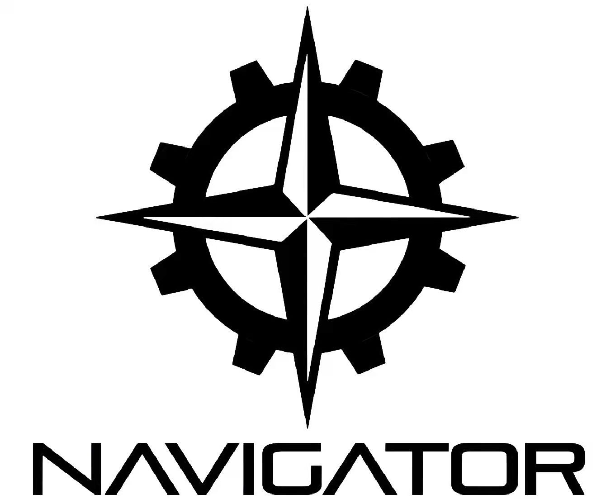

<div align="center">
  
  <h1>BNBU NAVIGATOR 视觉算法</h1>
  <p>RoboMaster 2027 视觉识别与自瞄项目</p>
</div>

## 项目简介

本仓库由 BNBU NAVIGATOR 战队维护，面向 RoboMaster 机器人视觉任务，提供目标检测、自瞄、位姿解算、目标跟踪、串口通信、相机标定以及无硬件仿真等功能。

项目以 C++ 为主，使用 OpenCV 处理图像、OpenVINO 执行目标检测，并通过 YAML 配置模型、相机、通信和算法参数。仓库同时提供 x86_64 与 aarch64 平台所需的相机 SDK 运行库，以及 OpenVINO 2024.6.0 运行环境（具体平台选择由 CMake 自动完成）。

> **项目来源说明**：本项目借鉴并重写了同济大学战队 TongjiSuperPower 开源的自瞄框架。当前代码已围绕 BNBU NAVIGATOR 的设备、通信协议与算法需求进行大量修改和扩展；我们仍尊重原项目的许可与来源，并在此明确致谢。仓库中的 [LICENSE](LICENSE) 保留了上游 MIT 许可证版权声明，请在再分发时一并保留。

## 功能概览

- **装甲板检测与识别**：支持 YOLOv5、YOLOv8、YOLO11 推理后端；可配置传统图像处理辅助修正。
- **位姿解算与坐标变换**：通过相机标定参数进行 PnP 解算，并结合云台姿态转换至世界坐标系。
- **目标跟踪与自瞄**：包含跟踪、瞄准决策和射击控制模块；IMM/EKF 参数可在配置文件中调整。
- **相机与通信**：集成海康、迈德威视相机适配，以及串口、CAN 和可选 ROS 2 接口。
- **多相机哨兵感知**：提供哨兵多线程入口和全向感知任务；此入口仅在找到所需 ROS 2 依赖时构建。
- **仿真与回放**：可用 fake 数据源模拟串口和相机输入，记录会话、注入异常并回放数据，无需连接真实下位机或相机。
- **标定与调试**：提供相机内参、外参标定程序，以及协议文档和跟踪器调参手册。

## 仓库结构

```text
RM_Vision_2027/
├── assets/                 # 模型文件与运行资源
├── assets-for-readme/      # README 图片
├── benchmarks/             # EKF 离线评估代码（当前未加入默认构建）
├── calibration/            # 相机内参、外参标定程序及说明
├── cmake/                  # 平台选择与 aarch64 交叉编译工具链
├── configs/                # 实车、虚拟运行及跟踪器 YAML 配置
├── docs/                   # 通信协议、滤波器调参等文档
├── io/
│   ├── can/                # CAN 通信
│   ├── hikrobot/           # 海康相机适配及 SDK
│   ├── mindvision/         # 迈德威视相机适配及 SDK
│   ├── ros2/               # ROS 2 接口（可选）
│   ├── serial/             # 串口、云台协议与 CRC
│   ├── sim/                # real/fake/replay 数据源和记录回放
│   ├── tf/                 # 坐标变换树
│   └── usbcamera/          # USB 相机适配
├── sim/                    # Python 虚拟下位机
├── src/                    # 程序入口
├── tasks/
│   ├── auto_aim/           # 装甲检测、PnP、跟踪、自瞄与射击
│   ├── auto_buff/          # 打符代码（当前不加入默认构建）
│   └── omniperception/     # 全向感知任务
├── tests/                  # 测试与硬件/ROS 2 调试入口
├── tools/                  # 通用算法与工具库
├── 3rd_part/               # 第三方运行时（含 OpenVINO）
├── CMakeLists.txt          # 顶层构建配置
├── LICENSE                 # 项目许可证
└── README.md
```

| 路径 | 用途 |
| --- | --- |
| `src/` | 程序入口：标准自瞄、步兵、哨兵和虚拟数据源运行器 |
| `tasks/auto_aim/` | 装甲板检测、YOLO、PnP、跟踪、自瞄与射击逻辑 |
| `tasks/omniperception/` | 哨兵全向感知及多相机相关任务 |
| `tasks/auto_buff/` | 打符相关代码，当前不加入默认构建 |
| `io/` | 相机、串口、CAN、坐标变换、ROS 2 和仿真数据源 |
| `tools/` | 日志、数学、滤波、线程及其他通用工具 |
| `configs/` | 实车、虚拟运行及跟踪器配置 |
| `assets/` | 神经网络模型及其他运行资源 |
| `calibration/` | 相机内参与外参标定程序；流程见 [calibration/README.md](calibration/README.md) |
| `sim/` | Python 虚拟下位机工具 |
| `docs/` | 通信协议、滤波器调参等技术文档 |

## 构建环境

- Linux；CMake 3.16.3 或更高版本
- 支持 **x86_64** 和 **aarch64**
- 支持 C++20 的 C++ 编译器（如 GCC）
- OpenCV、fmt、Eigen3、spdlog、yaml-cpp、nlohmann-json、libusb-1.0 开发包
- OpenVINO：默认优先使用仓库提供的 2024.6.0 运行库；也可以通过 `OpenVINO_DIR` 指定本机安装版本
- ROS 2 为可选依赖：未找到 ROS 2 时，标准自瞄、步兵及虚拟运行目标仍可构建；哨兵 ROS 2 目标会跳过

在 Ubuntu/Debian 系统上，常用系统依赖可通过以下命令安装：

```bash
sudo apt update
sudo apt install -y \
  build-essential cmake \
  libopencv-dev libfmt-dev libeigen3-dev libspdlog-dev \
  libyaml-cpp-dev nlohmann-json3-dev libusb-1.0-0-dev
```

仓库包含海康与迈德威视相机 SDK 的 x86_64、aarch64 运行库。使用真实 USB 相机时，还需按设备安装 udev 规则并确认相机 SDK 与设备权限正常；海康规则示例位于 `io/hikrobot/udev/51-mvs.rules`。

## 编译

在仓库根目录执行：

```bash
cmake -S . -B build -DCMAKE_BUILD_TYPE=Release
cmake --build build --parallel
```

CMake 会依据目标架构选择相机 SDK 与 OpenVINO 路径。aarch64 设备可直接本机编译；在 x86_64 主机交叉编译时，使用仓库提供的工具链文件，并准备匹配的 aarch64 sysroot：

```bash
cmake -S . -B build \
  -DCMAKE_TOOLCHAIN_FILE=cmake/aarch64-linux-gnu.cmake \
  -DAARCH64_SYSROOT=/path/to/aarch64-sysroot
cmake --build build --parallel
```

若希望使用系统安装的 OpenVINO，可在配置时指定其 CMake 配置目录：

```bash
cmake -S . -B build -DOpenVINO_DIR=/path/to/openvino/runtime/cmake
```

### 默认构建目标

| 可执行文件 | 说明 | 配置示例 |
| --- | --- | --- |
| `mt_standard` | 标准自瞄主程序，检测、跟踪、瞄准并通过串口发送指令 | `configs/mtstandard.yaml` |
| `soldier` | 步兵目标检测和 PnP 解算入口 | `configs/soldier.yaml` |
| `virtual_run` | 独立验证串口与相机 real/fake/replay 数据源 | `configs/virtual_example.yaml` |
| `calibrate_intrinsics` | 相机内参标定工具 | 运行 `--help` 查看参数 |
| `calibrate_extrinsic` | 相机外参标定工具 | 运行 `--help` 查看参数 |
| `sentry_multithread` | 哨兵多线程及全向感知入口；仅在配置时找到 ROS 2 依赖后生成 | `configs/sentry_example.yaml` |

`auto_buff`、无人机入口和 MPC planner 代码目前不属于默认构建目标。它们仍在仓库中的状态不代表已完成集成或可直接用于比赛。

## 运行

### 无硬件运行虚拟数据源

构建后可用内置 fake 串口和合成相机图像验证数据源链路：

```bash
./build/virtual_run configs/virtual_example.yaml --duration=8
```

如当前环境支持图形显示，可添加 `--show` 查看图像窗口；无显示器或远程无桌面环境不要添加该参数。虚拟运行配置还支持图片序列、视频、会话回放及串口/相机异常注入，详情见 `configs/virtual_example.yaml`、`configs/virtual_fault.yaml` 和 `configs/virtual_replay.yaml`。

也可以用虚拟数据源启动标准自瞄入口：

```bash
./build/mt_standard configs/mtstandard_virtual.yaml
```

### 连接真实设备

启动前请先核对对应 YAML 文件中的相机型号、相机参数、串口设备路径、波特率、敌方颜色和本车标定数据。仓库配置中的示例参数不一定适用于你的车辆。

步兵使用达妙 USB-CAN SDK，构建时需要指定 SDK 路径，见 [步兵 CAN 构建步骤](io/can/README.md#在小电脑上构建步兵程序)。

```bash
# 标准自瞄：需要匹配的相机、下位机和实车配置
./build/mt_standard configs/mtstandard.yaml

# 步兵入口
./build/soldier configs/soldier.yaml

# 步兵 Foxglove 调试：复用正式步兵的 CAN 2.0 处理，构建时需要 ROS 2
cmake --build build --target soldier_debug
./build/tests/soldier_debug

# 哨兵入口：仅在构建时检测到 ROS 2 依赖后可用
./build/sentry_multithread configs/sentry_example.yaml
```

步兵入口负责检测和位姿解算并发送云台指令，不接管发射。哨兵入口还依赖对应 ROS 2 环境与相机/通信配置。请在连接实车前检查所有输出指令和急停措施，并在安全场地完成验证。

### 录制与回放

`virtual_run` 支持将串口数据和相机帧记录到配置指定的目录。将数据源配置切换为 `replay` 并指向该目录，可复现录制会话。推荐先用虚拟数据源和录制数据验证改动，再连接真实设备。

Python 虚拟下位机（可选）：

```bash
python3 sim/virtual_mcu.py --port-file /tmp/vmcu.pts
```

脚本会报告伪串口路径；如需让程序通过普通串口接口读取该数据源，请在配置中使用这个路径，并按虚拟配置文档开启外部虚拟串口模式。

## 配置与标定

- **标准自瞄**：从 `configs/mtstandard.yaml` 开始，按车辆修改模型路径、相机、串口、相机内参和相机到云台的外参。
- **步兵**：使用 `configs/soldier.yaml`。它包含 YOLO、PnP、串口、CAN 和 ROS 2 调试等配置项。
- **哨兵**：使用 `configs/sentry_example.yaml`；全向相机数量、各相机参数和外参均需匹配实车。
- **虚拟运行**：使用 `configs/virtual_example.yaml`、`configs/virtual_fault.yaml` 或 `configs/virtual_replay.yaml`。
- **跟踪器**：IMM/EKF 参数位于 `configs/IMM.yaml`；调参建议见 [docs/ekf_imm_tuning.md](docs/ekf_imm_tuning.md) 和 [docs/kalman_tuning.md](docs/kalman_tuning.md)。

标定程序和标定步骤见 [calibration/README.md](calibration/README.md)。不要直接把仓库内的示例矩阵作为实车标定值；拆装相机或改变支架后应重新测量相应外参。

## 通信与算法文档

- [哨兵视觉节点通信协议](docs/sentry_serial_protocol.md)
- [IMM/EKF 调参手册](docs/ekf_imm_tuning.md)
- [Kalman 调参文档](docs/kalman_tuning.md)
- [相机标定流程](calibration/README.md)

## 测试与验证

默认构建中包含虚拟数据源运行器，可先运行：

```bash
./build/virtual_run configs/virtual_example.yaml --duration=8
```

根目录 CMake 当前未启用 `benchmarks/ekf` 离线基准子目录。`tests/` 中的部分程序是硬件或 ROS 2 调试入口，不等同于可在所有环境中直接运行的自动化单元测试。涉及相机、串口、CAN 或 ROS 2 的改动，应在对应硬件与软件环境中补充验证。

## 参与开发

1. 从对应入口及配置文件阅读当前实现，优先使用虚拟数据源复现问题。
2. 修改后本地构建并运行相关目标；涉及通信或坐标系时同步核对相应协议和标定文档。
3. 提交代码时说明目标程序、配置变化、测试方式和未覆盖的硬件条件。
4. 不要提交运行日志、录制数据、个人设备路径、密钥或未经授权分发的模型/SDK 文件。

## 致谢与许可

感谢同济大学战队 TongjiSuperPower 开源自瞄框架及其他上游依赖的贡献。本项目是在其基础上的大幅重写与持续改进；对于仍受上游许可证约束的代码和文件，继续遵循其原有许可要求。

本仓库许可证见 [LICENSE](LICENSE)。第三方库、模型、相机 SDK 和运行时可能具有各自独立的许可证与分发条款；使用或再分发前请分别查阅其许可文件及上游说明。
