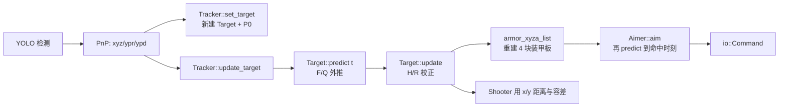

# 卡尔曼滤波调参手册（auto_aim）

> 适用代码：当前工作区的 `tasks/auto_aim/{target,tracker,aimer,shooter}.cpp`、`tools/extended_kalman_filter.*`。
> 文中的行号是编写本文时的快照，代码改动后请以 `grep -n` 重新确认；参数名和语义不会变。
>
> 调试前提：`debug_ros2` 已启用（`enable: true`），能看到 `/sp_debug/<tag>/ekf` 与 `/sp_debug/<tag>/image`。
> 遥测字段与实现见 `tasks/auto_aim/debug_stream.hpp`（`struct DebugStatus::Ekf`）与 `tasks/auto_aim/debug_stream.cpp`（`emit()` 第 6 段）。
> 注意：当前仓库里只有 `configs/soldier.yaml` 带 `debug_ros2` 段，跑哨兵调试入口（`sentry_multithread_debug`）时需要在你实际使用的 yaml 里补上这一段；哨兵的 `ekf` 话题前缀是 `/sp_debug/sentry`。

---

## 0. 一分钟结论

1. **先排除非 KF 误差**：PnP/标定、相机与检测延迟、云台 offset。KF 只能修正“模型与观测如何融合”，不能修正系统性偏差。
2. **一次只改一个参数**，幅度建议 ×0.5 / ×2，改完必须回放同一段数据对比。
3. 最常用的三个旋钮：
   - `v1`（位置/速度过程噪声）：响应快慢，`target.cpp:116`
   - `v2`（自转角速度过程噪声）：小陀螺跟不跟得上，`target.cpp:117`
   - `R_dig`（观测噪声）：平滑程度，`target.cpp:209-211`
4. 换场景前先看 `ekf` 话题：残差是否零均值、NIS 是否合理、`r` 是否收敛到真实半径。

---

## 1. 滤波器在系统中的位置

### 1.1 状态量（11 维）

定义见 `target.cpp:34-54`：

| 下标 | 符号 | 单位 | 含义 | 来源 |
|---|---|---|---|---|
| 0 | x | m | 整车旋转中心世界系 x | 观测 + 模型 |
| 1 | vx | m/s | 旋转中心 x 方向速度 | 模型 |
| 2 | y | m | 旋转中心世界系 y | 观测 + 模型 |
| 3 | vy | m/s | 旋转中心 y 方向速度 | 模型 |
| 4 | z | m | 旋转中心世界系 z | 观测 + 模型 |
| 5 | vz | m/s | 旋转中心 z 方向速度 | 模型 |
| 6 | a | rad | 当前装甲板相对旋转中心的相位角 | 观测 + 模型 |
| 7 | w | rad/s | 整车自转角速度 | 模型（观测量弱） |
| 8 | r | m | 第一组装甲板到旋转中心的半径 | 模型（准静态） |
| 9 | l | m | 半径差 `r2-r1` | 模型（准静态） |
| 10 | h | m | 高度差 `z2-z1` | 模型（准静态） |

要点：`r/l/h` **没有直接观测**，只靠多帧观测间接收敛；`w` 也只有角度观测间接支撑。这两组量是调参时最容易被“看起来不准”误伤的。

### 1.2 观测量（4 维）

`target.cpp:217-237`，`z = [yaw, pitch, distance, armor_yaw]`：

- `yaw/pitch`：装甲板中心在世界系的球坐标角（PnP 结果）
- `distance`：到装甲板中心的距离（单目尺度由装甲板物理宽度决定）
- `armor_yaw`：装甲板自身的朝向角

`H` 由 `h_armor_xyz()` + `xyz2ypd_jacobian()` 解析得到（`target.cpp:282-332`）。

### 1.3 调用链



关键时序：

1. 每帧先 `predict(t)` 到本帧图像时间戳，再用本帧观测 `update()`（`tracker.cpp:321-351`）。
2. 本帧没有匹配到装甲板时**只 predict 不 update**，靠模型撑过 `temp_lost`。
3. `Aimer::aim` 接收的是 `Target` 的**副本**，它内部的 `predict(future)` 不会污染 tracker 状态（`aimer.cpp:32-61`）。

---

## 2. 参数总表（文件 + 行号 + 当前值）

> 行号基于当前工作区；所有“硬编码”参数改完需要重新编译。

### 2.1 初始化

| 参数 | 位置 | 当前值 | 说明 | 可配置 |
|---|---|---|---|---|
| `P0_dig` | `tasks/auto_aim/tracker.cpp:301-312` | `{1,64,1,64,1,64,0.4,100,1,1,1}` | 新目标初始协方差（x,vx,y,vy,z,vz,a,w,r,l,h） | 否 |
| `radius` | 同上 | `0.2` | 初始半径，用于由单板反推旋转中心 | 否 |
| `armor_num` | 同上 | `4` | 每车装甲板数量，影响相位与 `l/h` 的定义 | 否 |
| `x0` | `tasks/auto_aim/target.cpp:54` | 观测值 + 速度/角速度置 0 | 初始状态 | 否 |

### 2.2 过程模型（predict）

| 参数 | 位置 | 当前值 | 说明 | 可配置 |
|---|---|---|---|---|
| `F` | `target.cpp:94-106` | 匀速 + 匀角速 | 状态转移 | 否 |
| `v1`（普通） | `target.cpp:116` | `100` | 加速度方差（m²/s⁴） | 否 |
| `v1`（前哨站） | `target.cpp:113` | `10` | 前哨站加速度方差 | 否 |
| `v2`（普通） | `target.cpp:117` | `400` | 角加速度方差（rad²/s⁴） | 否 |
| `v2`（前哨站） | `target.cpp:114` | `0.1` | 前哨站角加速度方差 | 否 |
| 前哨站转速上限 | `target.cpp:147-148` | `±2.51 rad/s` | 收敛后强制限幅 | 否 |
| 大 `dt` 判丢 | `tracker.cpp:48-51`、`135-138` | `0.1 s` | 超过即 `lost` | 否 |

### 2.3 观测模型（update）

| 参数 | 位置 | 当前值 | 说明 | 可配置 |
|---|---|---|---|---|
| `R_dig[0..1]` | `target.cpp:210` | `4e-3` rad² | yaw/pitch 观测方差（≈3.6° 标准差） | 否 |
| `R_dig[2]` | `target.cpp:210` | `log(|Δangle|+1)+1` m² | 距离观测方差，随“板面法向与视线夹角”增大 | 否 |
| `R_dig[3]` | `target.cpp:211` | `log(dist+1)/200+9e-2` rad² | 装甲板朝向观测方差 | 否 |
| 装甲板匹配 | `target.cpp:155-199` | 角度误差最小 | 决定本帧观测对应哪块板 | 否 |

### 2.4 状态机 / 门限

| 参数 | 位置 | 当前值 | 说明 | 可配置（yaml 键） |
|---|---|---|---|---|
| `min_detect_count` | `tracker.cpp:23` | 5 | 连续命中多少帧进入 `tracking` | `min_detect_count` |
| `max_temp_lost_count` | `tracker.cpp:24` | 25 | 普通目标允许的临时丢失帧数 | `max_temp_lost_count` |
| `outpost_max_temp_lost_count` | `tracker.cpp:25` | 75 | 前哨站允许的临时丢失帧数 | `outpost_max_temp_lost_count` |
| `diverged()` | `target.cpp:256-265` | `r∈(0.05,0.5)`、`r+l∈(0.05,0.5)` | 半径跑飞即丢弃目标 | 否 |
| `convergened()` | `target.cpp:267-279` | 普通 >3 次更新、前哨站 >10 次 | 认为已收敛 | 否 |
| `window_size` | `extended_kalman_filter.hpp:43` | 100 | NIS 统计窗口 | 否 |
| `nis_threshold` | `extended_kalman_filter.cpp:66` | `0.711` | NIS 失败阈值（**见第 8 节**） | 否 |
| `nees_threshold` | `extended_kalman_filter.cpp:67` | `0.711` | NEES 失败阈值（**见第 8 节**） | 否 |
| NIS 判丢 | `tracker.cpp:93-100` | 窗口内失败数 ≥ `0.4*window` | 直接置 `lost` | 否 |

### 2.5 下游耦合参数（不是 KF，但决定“看起来像不像 KF 的问题”）

| 参数 | 位置 | 说明 | 可配置（yaml 键） |
|---|---|---|---|
| `high_speed_delay_time` | `aimer.cpp:22` | `w > decision_speed` 时使用的延迟补偿 | 同名字段 |
| `low_speed_delay_time` | `aimer.cpp:23` | 低速时的延迟补偿 | 同名字段 |
| `decision_speed` | `aimer.cpp:24` | 高/低速判定阈值（rad/s） | 同名字段 |
| `comming_angle` / `leaving_angle` | `aimer.cpp:20-21`、`204-218` | 陀螺模式下选板策略 | 同名字段 |
| `yaw_offset` / `pitch_offset` | `aimer.cpp:17-19` | 枪管静态偏置 | 同名字段 |
| `first_tolerance` / `second_tolerance` / `judge_distance` | `shooter.cpp:13-15`、`27-31` | 开火角度容差与远近判定 | 同名字段 |
| `auto_fire` | `shooter.cpp:16` | 是否由视觉控制开火 | 同名字段 |

配置文件位置（哨兵）：`configs/sentry_example.yaml:223-241`，虚拟哨兵 `configs/sentry_virtual.yaml:172-192`。

---

## 3. 参数怎么影响行为（调大 / 调小的效果）

### 3.1 P0（`tracker.cpp:301-312`）

| 分量 | 当前值 | 含义 | 调大 | 调小 |
|---|---|---|---|---|
| x/y | 1 | 初始位置不确定度（m²） | 更信任首帧观测 | 更保守 |
| vx/vy | 64 | 初始速度不确定度（(m/s)²，std≈8 m/s） | 前几帧允许速度剧烈修正 → **容易过冲/甩头** | 速度收敛慢，但起步稳 |
| z/vz | 1/64 | 同上 | — | — |
| a | 0.4 | 初始角度不确定度（rad²） | 角度收敛快 | 角度收敛慢 |
| w | 100 | 初始角速度不确定度（std≈10 rad/s） | 首帧就能给出大角速度，**小陀螺起步快但 w 噪声大** | w 起步慢，换向时滞后 |
| r/l/h | 1/1/1 | 几何参数初始不确定度 | 几何参数收敛快但可能乱跳 | 收敛慢 |

**典型现象**：新目标刚出现时云台猛甩一下 → 优先降 `vx/vy`（64→16）和 `w`（100→25），而不是动 `v1/v2`。

### 3.2 `v1` / `v2`（`target.cpp:112-117`）

- `v1` 控制 **平移模型** 的可信度：
  - 调大：更相信新观测，加速/变向响应快，但静止目标会抖；
  - 调小：平滑，但平移目标会滞后，急停急起时预测落后。
- `v2` 控制 **自转模型** 的可信度：
  - 调大：小陀螺角速度估得快，跟得上突变，但 `w` 噪声大 → 瞄准点跳、开火抖动；
  - 调小：`w` 平滑，但加速/减速旋转时预测滞后，容易打早/打晚。

> Q 的结构是 piecewise white noise（`target.cpp:119-136`），`v1/v2` 是加速度方差，不是“速度”。

### 3.3 `R_dig`（`target.cpp:209-211`）

| 分量 | 调大 | 调小 |
|---|---|---|
| yaw/pitch（`4e-3`） | 更平滑，云台不追单帧噪声，但滞后 | 更信 PnP，响应快，但抖 |
| distance（角度相关项） | 深度更稳，远近判定不跳 | 深度跟得快，但可能前后跳 |
| armor_yaw（`9e-2` 起） | 更信模型，装甲板朝向稳定 | 更信 PnP 朝向，可能跳 |

经验：**先调 R 再调 Q**。R 太小是最常见的“抖动来源”，Q 太大是最常见的“超前/过冲来源”。

### 3.4 状态机参数（yaml）

- `min_detect_count`：5 → 3 更快锁定，但误检也会建目标；5 → 8 更稳，但切换目标慢。
- `max_temp_lost_count`：按**帧**计，不是按秒。120 fps 下 25 帧 ≈ 0.21 s；若降低帧率（如 30 fps），同样数值相当于 0.83 s，行为完全不同。改帧率必须重算这两个值。
- 前哨站 75 帧 ≈ 0.63 s @120fps。

### 3.5 下游延迟 / 选板

- `high/low_speed_delay_time`：补偿“检测→发弹”的系统延迟。发现**整体超前/滞后**且与目标转速无关时，先动这里，不要动 `v1/v2`。
- `comming_angle` / `leaving_angle`：只影响打哪块板，不影响 KF 状态。命中率问题要先区分是“瞄不准”还是“选错板”。
- `first/second_tolerance`：决定开火时机。开火晚/早先看这里。

---

## 4. 现象 → 调参决策表

> 顺序建议：先看 `ekf` 曲线确认是“估计问题”还是“下游问题”，再按表调。

| 现象 | 更可能的原因 | 优先调整 | 位置 |
|---|---|---|---|
| 静止目标框轻微抖动、云台高频小幅晃 | R 太小 / v1 太大 | 增大 `R_dig[0..1]`（4e-3→8e-3），或减小 `v1`（100→50） | `target.cpp:210`、`116` |
| 平移目标明显“拖尾”、云台追不上 | v1 太小 / R 太大 | 增大 `v1`（100→200），必要时减小 `R_dig[0..1]` | `target.cpp:116`、`210` |
| 小陀螺跟不上、经常掉锁 | v2 太小 / P0 的 w 太小 | 增大 `v2`（400→800），或增大 P0 的 w（100→200） | `target.cpp:117`、`tracker.cpp:301-312` |
| 小陀螺云台左右振荡、瞄准点跳 | v2 太大 / w 噪声大 | 减小 `v2`（400→200），或增大 `R_dig[3]` | `target.cpp:117`、`211` |
| 新目标出现瞬间猛甩/过冲 | P0 的 vx/vy/w 太大 | 降 P0：`64→16`、`100→25` | `tracker.cpp:301-312` |
| 上电后要很多帧才稳 | P0 太小 / R 太大 | 适当增大 P0 或减小 R | 同上 |
| 目标反复 `lost`，`data[5]` 接近 1 | NIS 阈值配置（见第 8 节）/ R 过小 / PnP 差 | 先核对 NIS 阈值；再看残差是否零均值 | `extended_kalman_filter.cpp:66` |
| 半径 `r` 慢慢跑到 0.05 以下或 0.5 以上 | 观测不足、装甲板类型判错、远距离 | 先修检测/类型；再降 P0 的 r 或增大距离 R | `target.cpp:258-261` |
| 前哨站转速估计过冲/来回跳 | 前哨站 `v1/v2` 与限幅 | 核对 `v1=10`、`v2=0.1`、限幅 `±2.51` | `target.cpp:112-114`、`147-148` |
| 近处瞄准稳定偏左/偏上 | 不是 KF | 调 `yaw_offset/pitch_offset` | `aimer.cpp:17-19` |
| 高速旋转时打早、低速时打晚 | 延迟补偿选错档 | 调 `decision_speed`、`high/low_speed_delay_time` | `aimer.cpp:22-24`、`42-43` |
| 明显打早/打晚但随距离变化 | 弹道/飞行时间，不是 KF | 核对弹速与 `Trajectory` | `aimer.cpp:72-118` |
| 开火时机太保守/太激进 | Shooter 容差 | 调 `first/second_tolerance` | `shooter.cpp:13-15` |
| 切换目标时云台绕远路 | 选板策略 | 调 `comming/leaving_angle` | `aimer.cpp:204-218` |

---

## 5. 标准调参流程（SOP）

1. **固定场景**
   - 至少准备 4 段：静止目标、匀速平移、小陀螺（正/反转）、前哨站。
   - 用回放（`src/virtual_run.cpp` + `configs/virtual_replay.yaml`）保证每次输入一致。
2. **采集基线**
   - 打开 `debug_ros2`，Foxglove 里同时开 `image` 和 `ekf`。
   - 记录 `data[0..9]` 的曲线与命中情况。
3. **判断问题类型**
   - 残差有系统性偏置（非零均值）→ 先查标定/PnP/时间戳，不要调 Q/R。
   - 残差零均值但抖动大 → 调 R。
   - 残差零均值但跟不上（残差与运动同相）→ 调 `v1/v2`。
   - `r` 不收敛 → 查类型/距离/观测数量。
4. **单变量修改**
   - 一次只改一个，幅度 ×0.5 或 ×2。
   - 硬编码参数改完重新编译；yaml 参数重启进程即可。
5. **对比**
   - 同场景 A/B 对比同一指标（见第 6 节），不要凭感觉。
6. **回滚**
   - 保留每次改动的 diff 和指标，避免“越调越乱”。

---

## 6. 用 `ekf` 话题判读（指标与目标区间）

话题：`/sp_debug/<tag>/ekf`，`std_msgs/Float64MultiArray`，顺序：

```
[0] residual_yaw      [1] residual_pitch   [2] residual_distance  [3] residual_angle
[4] nis               [5] nis_failure_rate [6] w                  [7] r
[8] l                 [9] h
```

判读建议（经验值，按实际相机/距离调整）：

| 指标 | 健康表现 | 异常含义 |
|---|---|---|
| `data[0..3]` | 均值≈0，无缓慢漂移；标准差小且稳定 | 有偏置 → 标定/PnP/时间同步；标准差大 → R 或检测质量 |
| `data[4]`（代码的后验 NIS） | 模型一致时均值约 3.1（标准先验 NIS 才是 4），随 `R/P_prior` 比例变化 | 长期远大于约 3~4 → R 太小/模型太乐观；长期接近 0 → R 远大于先验不确定度；绝对值不要直接按 χ²(4) 分位解读 |
| `data[5]`（窗口失败率） | 用修正后的先验 NIS + 9.488 时应约 0.05；当前实现仿真约 0.92 | 长期接近 1 → 当前阈值/统计量配置导致（见第 8 节），不代表目标真的异常 |
| `data[6]` w | 小陀螺时稳定在真实转速附近 | 抖动大 → v2/P0 w；跟不上 → v2 太小 |
| `data[7]` r | 收敛到真实半径（标准车约 0.2 m）±0.05 | 跑飞 → diverged 或类型判错 |
| `data[8..9]` l/h | 小幅波动，不应长期为 0 或突变 | 长期为 0 → 没有激励，属正常；突变 → 匹配/类型问题 |

注意：

- `ekf` 与图像一样受 `debug_ros2.image_hz` 节流（默认 15 Hz）。要全帧统计，把 `image_hz` 设为 0（带宽会明显变大）。
- 只有 tracker 产出 `Target` 时才发布；`lost` 时曲线中断是正常的。

---

## 7. 典型调参案例

### 案例 A：静止目标抖动

- 现象：`data[0..1]` 方差大，云台高频小幅晃。
- 处理：
  1. `R_dig[0..1]`：`4e-3 → 8e-3`（`target.cpp:210`）；
  2. 仍抖则 `v1`：`100 → 50`（`target.cpp:116`）；
  3. 观察 `data[0..1]` 方差是否下降、云台是否变“钝”。
- 副作用：平移目标开始滞后 → 回退一半。

### 案例 B：小陀螺掉锁

- 现象：`data[6]` 在旋转中来回跳，`data[7]` 时好时坏，`tracker` 频繁进入 `temp_lost`。
- 处理：
  1. `v2`：`400 → 800`（`target.cpp:117`）；
  2. 仍不够则 P0 的 `w`：`100 → 200`（`tracker.cpp:301-312`）；
  3. 若开始抖/超前，改回并增大 `R_dig[3]`（`target.cpp:211`）。

### 案例 C：新目标出现时甩头

- 现象：刚检测到目标，云台大幅过冲再回正。
- 处理：P0 的 `vx/vy` 与 `w` 减半（`tracker.cpp:301-312`），先不要动 `v1/v2`。
- 说明：首帧观测已经把位置设进 `x0`，过冲主要来自“允许速度/角速度在最初几帧大幅修正”。

---

## 8. 已知实现问题与风险（调参前必读）

1. **`nis` 不是标准 NIS，而是后验统计量（这一点已按代码核实）**
   - `extended_kalman_filter.cpp:49-63` 的实际顺序是：
     1. 用**先验** `P` 算 `K`；
     2. 用 Joseph 形式更新 `P`（变成后验）；
     3. 更新 `x`（变成后验）；
     4. 用**后验** `x` 算 `residual = z - h(x_post)`；
     5. 用**后验** `P` 算 `S = H P_post H' + R`；
     6. `nis = residual' S^-1 residual`。
   - 标准 NIS 应使用**先验**量：`r_pre = z - h(x_prior)`、`S_pre = H P_prior H' + R`，此时 `r_pre' S_pre^-1 r_pre ~ χ²(m=4)`。
   - 因此代码里的 `nis` 与 χ²(4) 只是“近似”，且**均值偏小**。用与代码同序的线性近似仿真（2 状态模型复刻 update 顺序，4 通道分别取 yaw/pitch、distance、armor_yaw 的当前 `v/R`）复核：
     - 标准先验 NIS：均值 `4.00`，`P(>0.711)=95.0%`，`P(>9.488)=5.0%`（与 χ²(4) 理论一致）；
     - 代码的后验 NIS：均值约 `3.13`，`P(>0.711)=92.2%`，`P(>9.488)=1.7%`。
   - 结论：**“0.711 会让绝大多数正常观测记为失败”这个方向是对的（仿真约 92%）**，但严格来说不是“因为 0.711 是 5% 下限，所以恰好 95%”；而是“阈值取在了远低于该统计量典型分布的位置”。换到目标比模型更平滑的场景，仿真失败率仍约 91%，结论不变。
2. **阈值 `0.711` 与判丢规则的真实后果**
   - 对标准 NIS（df=4），`0.711` 是 5% 下限，95% 上限是 `9.488`；当前代码用 `nis > 0.711` 判失败，等价于“只要不是极端贴合就失败”。
   - `tracker.cpp:93-100` 的判据是：最近 `window_size=100` 次 update 中失败次数 `≥ 0.4*window = 40` 就置 `lost`。按仿真约 92% 的失败率，连续跟踪约 40~45 次 update 后必然触发（120 fps、每帧一次 update 时约 0.35 s）。
   - **重要：只把阈值改成 9.488 而不修统计量，失败率会降到约 1.7%，`≥40%` 永远不成立，NIS 判丢等于被关掉。** 即使把统计量改成标准先验 NIS，9.488 对应的失败率也只有 5%，同样远低于 40%。
     - 也就是说：`≥40%` 这个判丢规则和任何合理的卡方尾概率都不匹配，需要一起重新设计（例如“窗口内平均 NIS > 9.488”，或把失败率阈值降到 10%~15%，或对单次超限只做“跳过该帧 update”的门控而不是丢目标）。
3. **`nees` 不是标准 NEES，且没有参与任何决策**
   - 代码算的是 `(x_post - x_prior)' P_post^-1 (x_post - x_prior)`。
   - 这个增量 `x_post - x_prior = K r_pre` 的真实协方差是 `P_prior - P_post`（秩 = 观测量维度 4），不是 `P_post`；所以它既不服从 χ²(4)，也不服从 χ²(11)。
   - 在当前参数下它的量级很小（单通道期望近似 `Pzz / R`），用 `0.711` 判失败没有统计意义。
   - 目前它只写入 `data["nees_fail"]`，不参与 tracker/aimer/shooter 的任何判断；调参时可直接忽略。
   - 真正的 NEES 需要目标真值 `e = x - x_true` 和 `e' P^-1 e ~ χ²(11)`，实车上拿不到，不建议使用。

4. **同一帧可能多次 update**
   - `tracker.cpp:337-348` 对每个同名同类型装甲板都执行一次 `update`（代码内有 TODO）。两帧观测等效把 R 减半，滤波器会过度自信。
   - 临时规避：只更新一块板（例如恢复注释里的 `min_x` 过滤，或匹配到第一块后 `break`），但要注意 `min_x` 是“最左侧”不是“最近”，需按场景选。
5. **前哨站参数需核对**
   - `set_target` 对前哨站走 `default` 分支：`radius=0.2`、`armor_num=4`（`tracker.cpp:310-312`），而上面注释保留的旧逻辑是 `0.2765` / `3`。
   - 若前哨站明显不对，先确认本赛季规则和 `armor_num`，再调 `v1/v2`。
6. **Aimer 高速档判定没有取绝对值**
   - `aimer.cpp:42-43` 是 `ekf_x()[7] > decision_speed_`，反向旋转会用低延迟档；`planner.cpp:101` 用的是 `std::abs`。
   - 正反转表现不一致时先看这里。
7. **延迟补偿不是 KF 参数**
   - `aimer.cpp:47-61` 的 `0.005 s` 是检测耗时假设；`to_now=true` 时用真实时间差。
   - 系统性超前/滞后先调 `high/low_speed_delay_time`，不要用 Q/R 去“补”。
8. **时间戳与帧率**
   - `predict(dt)` 的 `dt` 来自图像时间戳（`tracker.cpp:44-45`）。相机丢帧、YOLO 队列积压会让 `dt` 抖动，Q 调得再好也救不了。
   - `max_temp_lost_count` 是按帧计数，换帧率必须重算。
9. **`diverged()` 会直接丢目标**
   - `r` 或 `r+l` 超出 `(0.05, 0.5)` 即 `lost`（`target.cpp:256-265`）。远距离、大角度、类型判错都可能触发；先查 PnP，再考虑放宽范围。

### 8.1 建议的 NIS 修正（只在你打算用 NIS 判丢/门控时改）

按标准定义重写 `extended_kalman_filter.cpp:44-92`：

```cpp
// 必须在更新 P / x 之前计算先验量
const Eigen::VectorXd x_prior = x;
const Eigen::MatrixXd S = H * P * H.transpose() + R;   // 先验 S
const Eigen::MatrixXd K = P * H.transpose() * S.inverse();
const Eigen::VectorXd residual_pre = z_subtract(z, h(x_prior));

// 更新（与原实现一致）
P = (I - K * H) * P * (I - K * H).transpose() + K * R * K.transpose();
x = x_add(x, K * residual_pre);

// 标准 NIS，自由度 = 观测量维度 m = 4
const double nis = residual_pre.transpose() * S.inverse() * residual_pre;
```

阈值参考（χ²(4)）：`9.488` = 95%，`13.277` = 99%，`18.467` = 99.9%。

同时要改判丢规则：`tracker.cpp:93-100` 的“窗口失败率 ≥ 40%”与合理的卡方尾概率不匹配。建议二选一：

- 用窗口平均 NIS：`mean(nis over window) > 9.488` 判为持续不一致；
- 或保留失败率但把阈值降到 10%~15%（对应单帧 99% 以上的门限）。

若只想剔除偶发异常观测，建议在 `update()` 内部做单帧门控（超限就跳过该帧 update），不要直接丢目标。

---

## 9. 哪些参数改 yaml、哪些要重编译

| 类型 | 参数 | 修改方式 |
|---|---|---|
| yaml 可调 | `min_detect_count`、`max_temp_lost_count`、`outpost_max_temp_lost_count` | 改配置后重启 |
| yaml 可调 | `high/low_speed_delay_time`、`decision_speed`、`comming/leaving_angle`、`yaw/pitch_offset` | 改配置后重启 |
| yaml 可调 | `first/second_tolerance`、`judge_distance`、`auto_fire` | 改配置后重启 |
| 需重编译 | `P0_dig`、`radius`、`armor_num` | `tracker.cpp:301-312` |
| 需重编译 | `v1`、`v2`、前哨站限幅 | `target.cpp:112-117`、`147-148` |
| 需重编译 | `R_dig` | `target.cpp:209-211` |
| 需重编译 | `diverged()`、`convergened()` 阈值 | `target.cpp:256-279` |
| 需重编译 | NIS/NEES 阈值、窗口 | `extended_kalman_filter.cpp:66-67`、`hpp:43` |
| 需重编译 | 大 `dt` 判丢、NIS 判丢比例 | `tracker.cpp:48-51`、`93-100` |
| 需重编译 | Aimer 迭代次数/收敛阈值/`r<=2` 判据 | `aimer.cpp:86-118`、`175` |

> 建议：把最常调的 `v1/v2/R_dig/P0` 做成 yaml 键（带默认值），避免每次改参都重编译。这属于后续改造，不在本文范围内。

---

## 10. 行号索引（快速定位）

| 内容 | 位置 |
|---|---|
| 状态定义/注释 | `tasks/auto_aim/target.cpp:34-54` |
| 初始状态 x0 | `target.cpp:54` |
| P0 应用 | `target.cpp:55`、`64` |
| predict / F / Q | `target.cpp:83-151` |
| 普通 v1/v2 | `target.cpp:116-117` |
| 前哨站 v1/v2 | `target.cpp:112-114` |
| 前哨站限幅 | `target.cpp:147-148` |
| update / 匹配 | `target.cpp:153-200` |
| R_dig | `target.cpp:206-214` |
| 观测函数 h | `target.cpp:217-237` |
| 4 板重建 | `target.cpp:244-254` |
| diverged / convergened | `target.cpp:256-279` |
| h_armor_xyz / H | `target.cpp:282-332` |
| EKF predict | `tools/extended_kalman_filter.cpp:28-35` |
| EKF update | `tools/extended_kalman_filter.cpp:44-92` |
| NIS/NEES 阈值 | `tools/extended_kalman_filter.cpp:66-67` |
| NIS 窗口 | `tools/extended_kalman_filter.hpp:42-43` |
| tracker 参数读取 | `tasks/auto_aim/tracker.cpp:21-27` |
| 大 dt 判丢 | `tracker.cpp:48-51`、`135-138` |
| NIS 判丢 | `tracker.cpp:93-100` |
| 状态机 | `tracker.cpp:212-261` |
| P0 / radius / armor_num | `tracker.cpp:299-313` |
| 每帧 predict + update | `tracker.cpp:321-351` |
| Aimer 延迟 | `tasks/auto_aim/aimer.cpp:42-61` |
| Aimer 选板 | `aimer.cpp:154-221` |
| Shooter 容差 | `tasks/auto_aim/shooter.cpp:12-42` |
| 遥测发布（ekf） | `tasks/auto_aim/debug_stream.cpp:690-704` |
| 遥测字段定义 | `tasks/auto_aim/debug_stream.hpp:28-47` |
| 哨兵调试填充 | `tests/sentry_multithread_debug.cpp:401-448` |

---

## 11. 调参记录模板（建议复制使用）

```
日期：
场景（静止/平移/小陀螺/前哨站）：
改动前：v1=__ v2=__ R_yaw=__ R_dist=__ R_armor=__ P0=__
改动后：v1=__ v2=__ ...
指标（改动前 -> 改动后）：
  residual_yaw std：
  residual_distance std：
  NIS 均值/尖峰：
  data[5]：
  r 收敛值：
  命中率/掉锁次数：
观感：
是否回滚：
备注：
```
